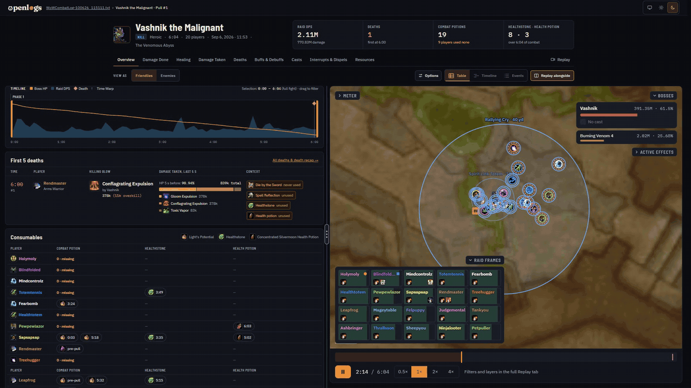
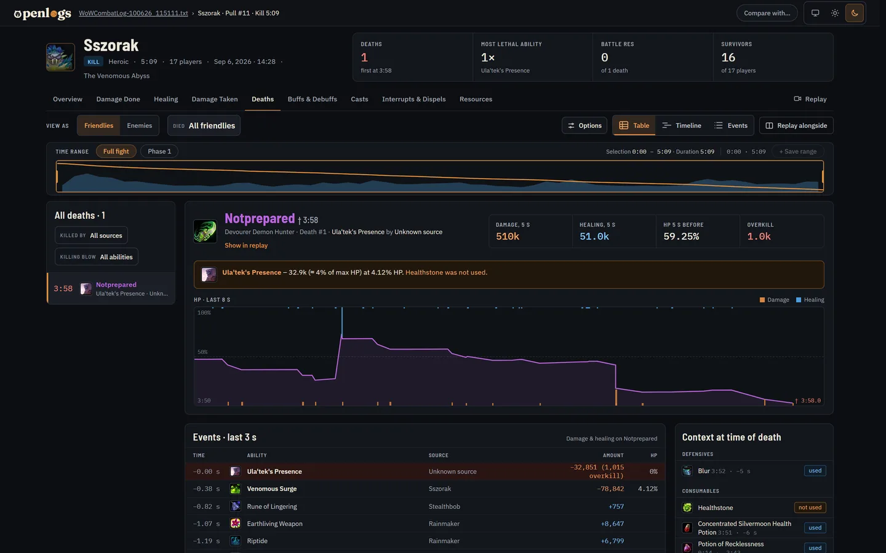
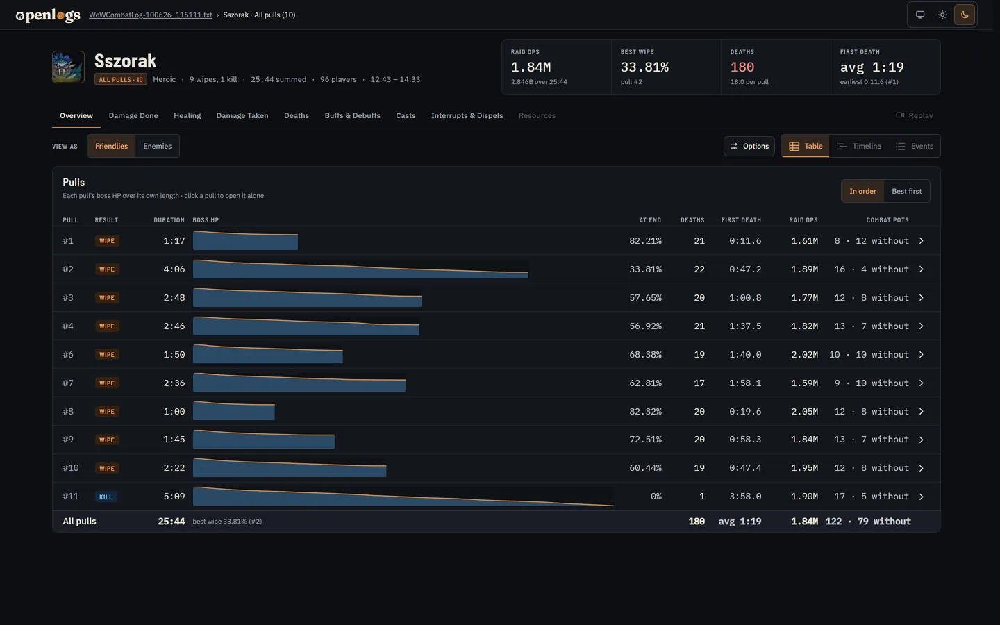

<h1 align="center">
  <picture>
    <source media="(prefers-color-scheme: dark)" srcset="brand/openlogs-wordmark-on-dark.svg">
    
  </picture>
</h1>

<p align="center"><b>Know why you wiped before you pull again.</b></p>

<p align="center">
  <a href="https://app.openlogs.gg">Open in browser</a> ·
  <a href="https://github.com/Shaydera/OpenLogs/releases">Download for Windows</a> ·
  <a href="https://openlogs.gg">openlogs.gg</a>
</p>



OpenLogs reads your World of Warcraft combat log straight from disk and analyses it on your own machine, in the browser or as a desktop app. Nothing is uploaded, there is no account, and a raid night of several gigabytes is ready in a few seconds. It reads raids and Mythic+ runs, and it is free and open source.

## Raid night, pull by pull

Open the log after a wipe and the new pull is already in the list. Everything else works on one pull, on all pulls of a boss together, or on any stretch of time you drag over the timeline.

### Why someone died

The last seconds before a death: every hit and heal, the HP line, and which defensives and potions were still available or on cooldown.



### All pulls of a boss in one table

Boss HP over each pull, deaths, first death, raid DPS and potions side by side, so you see whether the raid is getting closer and what keeps ending the pull.



## Features

- **Pull list** grouped by boss and Mythic+ run, with kill/wipe, duration and boss HP at the end; while the game is still writing the log, new pulls appear on their own (desktop app, Chrome and Edge)
- **Quick overview** of a pull: timeline with boss HP, raid DPS, deaths and Bloodlust; the first deaths with their killing blow; consumables; major cooldowns per player
- **All pulls, all wipes or all kills** of a boss analysed together
- **Damage done, healing and damage taken** with breakdowns by ability and target, per-player and per-ability pages, and full Augmentation Evoker support: their support damage shown as logged or credited back to the Evoker
- **Deaths** with a recap of the last seconds: hits, heals, HP and the defensives that were (not) used
- **Buffs & debuffs, casts, interrupts & dispels and resources** tabs
- **Time ranges**: drag over the timeline or pick a phase, and every view recalculates for that range; ranges can be saved per boss. Pulls can also be cut off at the Nth player death
- **Replay** of positions on the boss map, on its own or next to any report
- **Compare two pulls** side by side
- Light and dark themes

## Your log stays on your PC

The analysis runs right where the file is: in your browser as WebAssembly or in the desktop app. OpenLogs never sends the log anywhere. It is indexed once and the index is kept locally, so opening it again is instant; a 3–4 GiB raid log is indexed in under 5 seconds.

- **In the browser** at [app.openlogs.gg](https://app.openlogs.gg): nothing to install. Works in current Chrome, Edge and Firefox; Chrome and Edge reopen recent logs with one click (the browser may ask to allow reading the file), other browsers ask you to choose the file again.
- **Desktop app** from the [releases](https://github.com/Shaydera/OpenLogs/releases): the same app in its own window (Tauri). Installs like any Windows program on Windows 10 and 11, works offline and tells you when a new release is out (you can turn that off in the settings).

## Get started

1. In the game, turn on *Advanced Combat Logging* under System, Network.
2. Type `/combatlog` before the pull. The game writes the log to `World of Warcraft/_retail_/Logs`.
3. Open the `WoWCombatLog` file in OpenLogs, in the browser or the desktop app.

A pull shows up once its encounter has ended.

## Building

Requirements: Rust 1.95 or newer with the `wasm32-unknown-unknown` target, [`wasm-bindgen-cli`](https://github.com/wasm-bindgen/wasm-bindgen) in the version `crates/openlogs-wasm/Cargo.toml` pins, and Node.js 22.18 or newer. The desktop app also needs the [Tauri prerequisites](https://tauri.app/start/prerequisites/) (on Windows: WebView2 and the MSVC build tools).

```sh
rustup target add wasm32-unknown-unknown
cargo install wasm-bindgen-cli --version 0.2.129
npm install
npm --prefix ui install
npm --prefix ui run gamedata   # download spell icons, dungeons and boss portraits
```

Website:

```sh
npm --prefix ui run dev        # run with hot reload on http://localhost:5173
npm --prefix ui run images     # download the game images the website serves itself
npm --prefix ui run build:web  # static site in ui/dist, with the images
```

`npm --prefix ui run build` builds the same site without the images; it loads them from the Wowhead CDN instead, like the desktop app.

Desktop app:

```sh
npm run tauri dev              # run the app with hot reload
npm run tauri build            # build an installer
```

Tests:

```sh
cargo test --workspace
npm --prefix ui test
```

The workspace also contains a small CLI that lists the fights in a log:

```sh
cargo run -p openlogs-cli -- dump-fights path/to/WoWCombatLog.txt
```

## Project layout

| Path | Contents |
|---|---|
| `crates/openlogs-parser` | Streaming combat log parser |
| `crates/openlogs-index` | Encounter and Mythic+ index of a log |
| `crates/openlogs-analysis` | Fight model and all reports |
| `crates/openlogs-service` | The reports in the shape the UI shows |
| `crates/openlogs-wasm` | The engine the app runs as WebAssembly |
| `crates/openlogs-gamedata` | Spell icons, dungeon data and curated cooldown lists |
| `crates/openlogs-cli` | Command-line tools, including the game data export |
| `src-tauri` | Desktop app window (Tauri) |
| `ui` | User interface (React, TypeScript) |
| `brand` | Logo files |

## Data sources

Spell, class and boss images and map art come from the Wowhead CDN; spell icon names, dungeon and boss data from [wago.tools](https://wago.tools). The game data is exported with each release (`npm --prefix ui run gamedata`) and ships with the app. The website also ships the images, so it sends no requests to third parties; the desktop app loads them from the Wowhead CDN. Without a network connection the app still works; missing images show the initials of their name instead.

World of Warcraft is a trademark of Blizzard Entertainment. OpenLogs is not affiliated with Blizzard or RPGLogs.

## AI disclosure

How much AI went into OpenLogs differs between its two parts.

In the Rust engine in `crates`, which parses and analyses the logs, AI only plays a supporting role: mainly for chores such as refactoring, code reviews, bug hunting and parts of the documentation. Nothing lands there that I have not reviewed by hand.

The user interface relies on AI much more heavily: most of the React code in `ui` is AI-generated.

This describes my own code (Shaydera). For contributions by others, I can't say how they were written.

## Privacy

Logs, settings and indexes stay on your device; there are no cookies and no tracking. The website and web app are covered by the [privacy notice on openlogs.gg](https://openlogs.gg/privacy.html), the desktop app and your own builds by [PRIVACY.md](PRIVACY.md).

## Contributing

Pull requests go against `development`; `main` holds the latest release. See [CONTRIBUTING.md](CONTRIBUTING.md), including the contributor license agreement.

## License

Copyright 2026 Shaydera

OpenLogs is free software: you can redistribute it and/or modify it under the terms of the GNU Affero General Public License as published by the Free Software Foundation, either version 3 of the License, or (at your option) any later version. It comes without any warranty; see [LICENSE](LICENSE) for the full terms. If you run a modified version for others over a network, you have to offer them its source code.

The license covers OpenLogs itself. Third-party components such as the fonts keep their own licenses, and World of Warcraft game data and images belong to Blizzard Entertainment.
